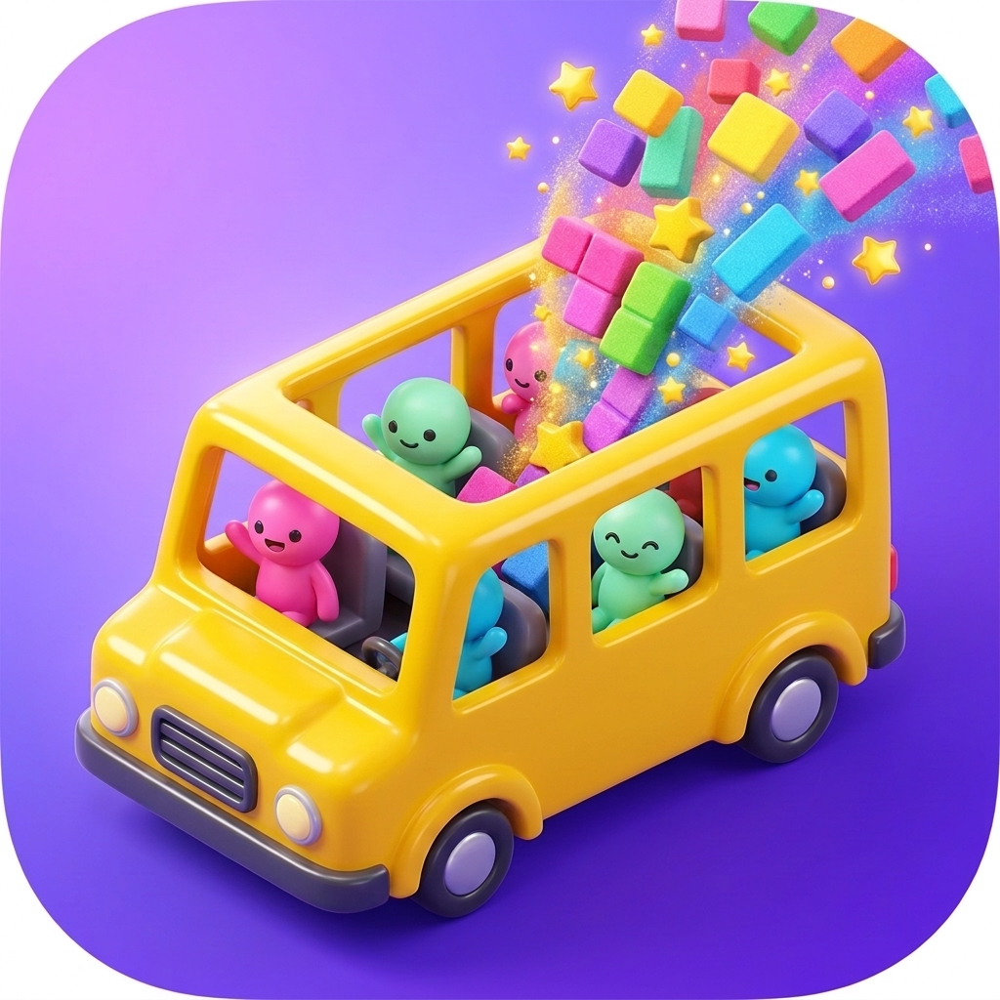
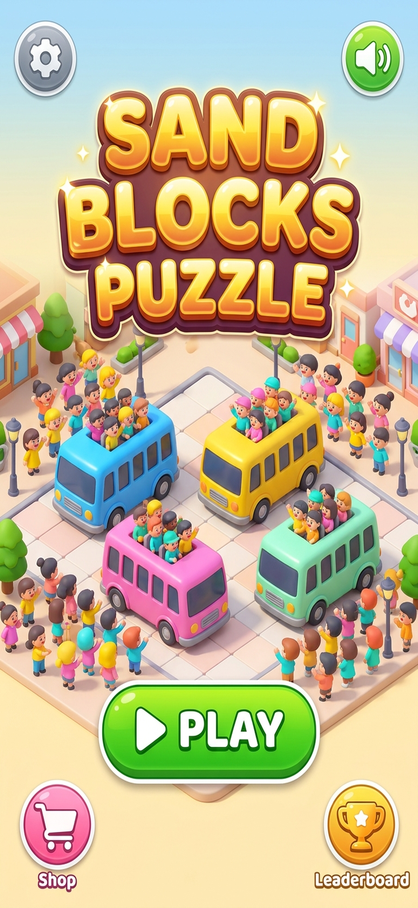
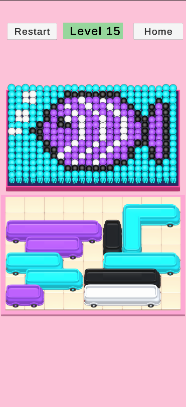
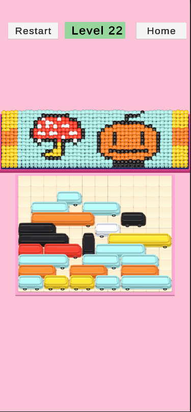
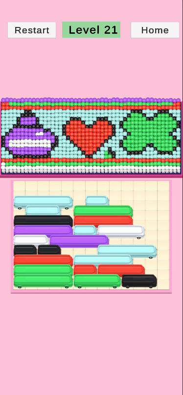

# crowd-blocks-puzzle

<p align="center">
  
</p>

<p align="center">
  <b>A Satisfying 3D Mobile Physics & Sliding Bus Puzzle Game</b><br>
  <i>Designed for Android & iOS in Native Portrait Phone Resolution</i>
</p>

<p align="center">
  
  
  
  
</p>

---

## 📱 Mobile Visuals & Screenshots

<p align="center">
  
  &nbsp;&nbsp;&nbsp;&nbsp;
  
  &nbsp;&nbsp;&nbsp;&nbsp;
  
</p>

<p align="center">
  <i><b>Left:</b> Native mobile Home Screen (1125x2436). <b>Center:</b> In-game puzzle board & crowd queue. <b>Right:</b> Commuter boarding & collection action.</i>
</p>

<br>

<p align="center">
  
</p>
<p align="center">
  <i><b>Close-up:</b> Dynamic PBD fluidic crowd particles with custom Toon Shading standing in line for colored buses.</i>
</p>

---

## 🎮 Game Concept & How to Play

**Crowd Blocks Puzzle** combines the spatial brain-teaser of sliding traffic puzzles with the visual and physical satisfaction of fluidic crowd mechanics.

### Core Loop
1. **Slide the Buses**:
   - Drag modular buses horizontally or vertically along grid lanes with a single swipe.
   - Clear intersecting traffic jams to maneuver target buses toward the collection line at the front of the queue.

2. **Fluidic Crowd Dynamics**:
   - Commuters are simulated as dynamic particles using **Position-Based Dynamics (PBD)**.
   - As front-row passengers board buses, the remaining crowd smoothly flows downward like colorful crowd to fill the empty spaces.

3. **Color Matching & Boarding**:
   - Buses and passengers are color-coded (Yellow, Green, Pink, Blue, etc.).
   - When a bus arrives in the collection bay, matching commuters animate, run forward, and take seats inside the bus.
   - Filled buses trigger an exit sequence, freeing parking lanes for the next puzzle maneuvers.

---

## 🛠️ Architecture & Technical Features

### 1. Position-Based Dynamics (PBD) Crowd Physics
- **`PBDCrowdSimulation.cs`**: Custom physics engine that solves particle-particle distance constraints, velocity damping, and settling logic in real time.
- **`ContainerBoundary.cs`**: Defines the physical container boundaries, collision walls, and elevation plates that hold the crowd.

### 2. Stylized Mobile Rendering
- **Universal Render Pipeline (URP)**: Configured with **Forward Rendering** for optimal performance, smooth frame rates, and low battery consumption on mobile chipsets.
- **Unity Toon Shader (UTS3)**: Provides clean, vibrant, toy-like visuals with specular highlights and per-character dynamic outlines.
- **`CharacterPassenger.cs`**: Handles procedurally animated character states (Idle, Walk, Run, Sit) and injects dynamic palette colors using `MaterialPropertyBlock` without instantiating separate materials.
- **`InstancedCrowdRenderer.cs`**: Efficiently pools character instances to eliminate runtime garbage collection (GC) and maintain a stable 60 FPS.

### 3. Modular Grid & Vehicle Controller
- **`PuzzleGrid.cs` & `UnifiedGridManager.cs`**: Handles discrete multi-tile cell occupancy, pathfinding clearance, and spatial queries.
- **`BusVehicle.cs` & `ModularBusPiece.cs`**: Composable vehicle system allowing straight or extended bus lengths with configurable seat capacities.
- **`VehicleDragHandler.cs`**: Responsive single-finger touch drag with axis constraints and grid-snapping.

### 4. Audio & Haptics
- **`AudioManager.cs`**: Centralized sound effects for vehicle slides, engine starts, crowd chatter, and level completion fanfares.
- **`HapticManager.cs`**: Tactile vibration feedback on bus stops, snaps, and passenger boarding for enhanced physical satisfaction.

---

## 📁 Project Directory Structure

```plaintext
Crowd Blocks Puzzle/
├── Assets/
│   ├── Game/                      # 3D vehicle models, passenger prefabs, and textures
│   ├── Crowd Block Puzzle/
│   │   ├── Materials/             # URP Lit and Toon materials
│   │   ├── Models/                # Character models & modular bus parts
│   │   ├── Prefabs/               # Bus prefabs, character prefabs, and UI elements
│   │   ├── Scene/
│   │   │   └── Gameplay.unity     # Core game scene
│   │   ├── Scripts/
│   │   │   ├── Core/
│   │   │   │   ├── Audio/         # AudioManager sound effects & music
│   │   │   │   ├── Boundary/      # Crowd boundary physics & geometry
│   │   │   │   ├── Data/          # Color palettes and level data structures
│   │   │   │   ├── Haptics/       # Mobile tactile haptic feedback
│   │   │   │   ├── Rendering/     # Instanced crowd rendering & outlines
│   │   │   │   └── Simulation/    # PBD crowd physics engine
│   │   │   ├── Editor/            # Custom level editor & build tools
│   │   │   ├── Gameplay/          # GameManager, passenger transfer, camera framing
│   │   │   └── Puzzle/            # Grid system, vehicle drag, bus mechanics
│   │   ├── Settings/              # Mobile URP Quality & Renderer assets
│   │   ├── Shaders/               # Custom URP crowd & toon shaders
│   │   └── UI/                    # Portrait mobile UI, icons, and menus
│   └── TutorialInfo/              # Project setup info
├── ProjectSettings/               # Unity project, quality, and graphics settings
├── screenshots/                   # Portrait phone screenshots for documentation
└── README.md                      # Project documentation
```

---

## 🚀 Getting Started

### Prerequisites
- **Unity Editor**: Version **`6000.3.6f1` (Unity 6)** or newer.
- **Installed Modules**:
  - **Android Build Support** (with Android SDK & NDK Tools).
  - **iOS Build Support** (optional, for iOS export on macOS).

### Running in the Unity Editor
1. Clone this repository to your local machine:
   ```bash
   git clone <repository-url>
   ```
2. Open **Unity Hub** and add the project folder.
3. Open the project with **Unity 6 (`6000.3.6f1`)**.
4. In the Project window, open `Assets/Crowd Block Puzzle/Scene/Gameplay.unity`.
5. In the **Game** view tab, set the aspect ratio to **Portrait**:
   - Choose **9:16 Portrait** or a phone resolution (e.g., `1080 x 1920` or `1125 x 2436`).
6. Press the **Play** button to play the game in the editor.

---

## 📦 Building the Game for Mobile

### Android Build
1. Open **File > Build Settings...** (`Ctrl + Shift + B`).
2. Select **Android** from the Platform list and click **Switch Platform**.
3. Verify that `Assets/Crowd Block Puzzle/Scene/Gameplay.unity` is added to the **Scenes In Build** list.
4. Set **Build System** to **Gradle**.
5. Click **Build** to generate the `.apk` or **Build App Bundle** (`.aab`) for Google Play.

### iOS Build (macOS)
1. In **File > Build Settings...**, switch platform to **iOS**.
2. Click **Build** to export the Xcode project.
3. Open the generated project in **Xcode**, configure your Signing & Capabilities, and deploy to your iOS test device.

---

## 🎨 Level Design & Palette Customization

- **Color Palettes**: Palette ScriptableObjects are located at:
  - `Assets/Crowd Block Puzzle/Settings/CrowdColorPalette.asset`
- **Level Configurations**: Level layouts and grid setups are managed through:
  - `Assets/Crowd Block Puzzle/Scripts/Core/Data/LevelData.cs`
- Additional levels can be created and previewed directly in the Unity Editor using the custom tools in `Assets/Crowd Block Puzzle/Scripts/Editor/`.

---

## 📄 License
This project is proprietary and intended for mobile development and publication. All rights reserved.
